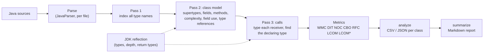

# java-quality-analyzer

`jqa` computes the Chidamber–Kemerer object-oriented metrics (WMC, DIT, NOC, CBO, RFC, LCOM)
and Henderson-Sellers' LCOM* for every class in a Java source tree, and writes the results as CSV or JSON.

[](https://openjdk.org/)
[](LICENSE)
[](https://github.com/yousefibehnam/java-quality-analyzer/actions/workflows/ci.yml)

## Background

Originally developed in 2017–2018 during my M.Sc.
This repository is a clean re-implementation written in 2026.

## Features

- **Seven class-level metrics**: WMC (sum of McCabe complexity), DIT, NOC, CBO (both coupling directions),
  RFC, LCOM (Chidamber–Kemerer) and LCOM* (Henderson-Sellers).
- **Source only.** You don't need to compile the code you analyse or provide its dependencies. Names are
  resolved through imports, packages and nesting. JDK types are checked against the running JDK by
  reflection, which gives exact DIT values for classes that extend JDK classes.
- **Call-receiver typing** for RFC and CBO. It follows locals, fields, inherited methods, static imports
  and call chains. It resolved 95–98% of call sites in the case studies, and the tool reports this rate
  for every run.
- **Honest output.** DIT is flagged as a lower bound when a supertype is unknown. LCOM* is left empty when
  it is undefined. Files that fail to parse are reported and skipped, so one bad file doesn't stop the run.
- **Documented definitions.** Every metric has a precise definition in [docs/metrics.md](docs/metrics.md),
  and each one is unit-tested against hand-written classes whose values were worked out by hand.
- **CLI with two commands.** `analyze` writes CSV or JSON. `summarize` turns several CSV files into a
  Markdown report with distributions, the largest classes and Spearman correlations.

## Method



1. **Parse.** Every `.java` file is parsed with JavaParser. The language level is Java 21, so
   newer syntax in the analysed code is accepted.
2. **Index.** The qualified names of all declared types are collected first, so that references
   between project types can be resolved in any order.
3. **Model.** Each type gets its supertypes, its fields, and its methods with their
   cyclomatic complexity, the fields each method uses, and every type the class mentions.
4. **Calls.** Each call is attributed to the type that declares the called method. This pass
   runs last because it needs every method signature and return type in the project.
5. **Metrics.** The values are computed from the model, following the definitions in
   [docs/metrics.md](docs/metrics.md). For example, CBO counts couplings in both directions,
   and RFC = declared methods + distinct called methods.

## Dataset

There is no dataset in the usual sense. The case studies analyse the production sources of
three widely used open-source Java projects at pinned release tags. Their source code is
**not** included in this repository. [`scripts/run_case_studies.sh`](scripts/run_case_studies.sh)
clones each one into `data/` (git-ignored) and checks that it is at the expected tag.

| Project | Tag | License | Analysed directory |
|---|---|---|---|
| [Apache Commons Lang](https://github.com/apache/commons-lang) | `rel/commons-lang-3.21.0` | Apache-2.0 | `src/main/java` |
| [Apache Commons IO](https://github.com/apache/commons-io) | `rel/commons-io-2.22.0` | Apache-2.0 | `src/main/java` |
| [JUnit 4](https://github.com/junit-team/junit4) | `r4.13.2` | EPL-1.0 | `src/main/java` |

The `results/` directory contains only metric values (numbers per class name) derived from
these projects.

## Installation and usage

You need JDK 17 or newer and Maven 3.9+. Build the tool, run the tests, and analyse a source tree:

```bash
mvn -B package && java -jar target/jqa.jar analyze path/to/src/main/java
```

More options:

```bash
java -jar target/jqa.jar analyze src/main/java --format json -o metrics.json
java -jar target/jqa.jar analyze src/main/java -o metrics.csv --stats metrics.stats.properties --include-jdk
java -jar target/jqa.jar summarize -o summary.md app=metrics.csv
```

Output columns: `class, kind, file, methods, fields, wmc, dit, dit_exact, noc, cbo, rfc, lcom, lcom_star`.

To reproduce the case studies (clone the three projects, analyse them, summarise), run this. It
takes about 4 s plus clone time:

```bash
scripts/run_case_studies.sh
```

## Results

These numbers come from `scripts/run_case_studies.sh` on JDK 25.0.3. The full report, with the
per-project tables, is in [results/summary.md](results/summary.md), and the per-class values are
in `results/*.csv`. Distributions cover classes, enums and records; interfaces and annotation
types are excluded.

**Coverage of the analysis**

| Project | Source files | Types | Classes, enums, records | Parse failures | Call sites resolved | Type references resolved |
|---|---:|---:|---:|---:|---:|---:|
| Commons Lang 3.21.0 | 246 | 377 | 291 | 0 | 97.6% | 98.8% |
| Commons IO 2.22.0 | 261 | 365 | 328 | 0 | 95.3% | 99.0% |
| JUnit 4.13.2 | 207 | 274 | 224 | 0 | 98.3% | 99.8% |

**Median (P90) per class**

| Metric | Commons Lang | Commons IO | JUnit 4 |
|---|---:|---:|---:|
| WMC | 8 (70) | 7 (30.3) | 5 (26) |
| DIT | 1 (3) | 2 (4) | 1 (3) |
| NOC | 0 (0) | 0 (1) | 0 (1) |
| CBO | 3 (10) | 3 (7) | 5 (13.7) |
| RFC | 12 (66) | 10.5 (38.6) | 8 (39.4) |
| LCOM | 3 (276) | 1 (58.3) | 1 (63.6) |
| LCOM* | 0.94 (1.03) | 0.87 (1.50) | 0.88 (1.00) |

**Largest classes by WMC**

| Project | Class | WMC | RFC | CBO |
|---|---|---:|---:|---:|
| Commons Lang | `ArrayUtils` | 1083 | 488 | 42 |
| Commons Lang | `StringUtils` | 903 | 386 | 43 |
| Commons IO | `IOUtils` | 316 | 284 | 74 |
| Commons IO | `FileUtils` | 283 | 334 | 33 |
| JUnit 4 | `org.junit.Assert` | 106 | 98 | 14 |
| JUnit 4 | `ParentRunner` | 66 | 101 | 38 |

**Spearman rank correlation, all 843 classes pooled (selected pairs)**

| Pair | ρ |
|---|---:|
| WMC – RFC | 0.94 |
| WMC – LCOM | 0.71 |
| WMC – CBO | 0.41 |
| WMC – LCOM* | −0.01 |
| DIT – WMC | −0.24 |

**Observations**

- All size-related metrics are strongly right-skewed. Commons Lang's mean WMC is 32.1, but its
  median is 8. The extreme values belong to static utility classes (`ArrayUtils`, `StringUtils`,
  `IOUtils`, `FileUtils`), which hold hundreds of overloads.
- WMC and RFC almost rank classes the same way (ρ = 0.94), so in these projects they carry largely
  overlapping information.
- LCOM grows with class size (ρ = 0.71 with WMC), but the normalised LCOM* does not (ρ = −0.01).
  That makes LCOM* the more useful of the two for comparing classes of different sizes.
- Commons IO has deeper inheritance (median DIT 2) than the other two projects (median 1). About
  half of its classes that use `extends` (76 of 150, by a text search) extend stream, reader or
  writer types from `java.io` or Commons IO's own proxies of them, and those JDK supertypes count
  toward DIT.

## Project structure

```
java-quality-analyzer/
├── pom.xml                       Maven build (Java 17 bytecode, shaded jqa.jar)
├── docs/metrics.md               exact metric definitions and modelling choices
├── scripts/run_case_studies.sh   clones the case-study projects and regenerates results/
├── results/                      per-class CSVs, resolution stats, summary.md
└── src/
    ├── main/java/io/github/yousefibehnam/jqa/
    │   ├── parser/     SourceScanner: find and parse .java files
    │   ├── resolve/    TypeResolver (imports, packages, nesting), JdkTypes (reflection)
    │   ├── model/      ClassInfo, MethodInfo, FieldInfo, MethodCall, ProjectModel
    │   ├── build/      ModelBuilder (3 passes), ComplexityCounter, BodyAnalyzer, CallCollector
    │   ├── metrics/    Wmc, Dit, Noc, Cbo, Rfc, Lcom, MetricsCalculator, ResolutionStats
    │   ├── report/     CSV and JSON writers
    │   ├── summary/    Statistics (quantiles, Spearman), SummaryReport
    │   └── cli/        picocli commands: analyze, summarize
    └── test/
        ├── java/...                unit tests per package
        └── resources/fixtures/     hand-written classes with hand-computed expected values
```

## Limitations and future work

- **No full type inference.** Receivers typed by generics (`list.get(0).foo()`), lambda parameters
  without declared types, `var` with non-`new` initialisers, and array elements stay unresolved.
  Unresolved calls are identified by name and arity in RFC and add nothing to CBO. The resolution
  rates above show how often this happens.
- **Overloads.** Methods are identified by name and number of arguments, not parameter types, so
  overloads with the same arity are counted as one called method in RFC.
- **Scopes are flattened.** A local variable anywhere in a method hides a field with the same name
  for the whole method. Member types inherited from supertypes are not searched.
- **JDK-dependent DIT.** Depth through JDK supertypes is measured on the JDK that runs the tool,
  and JDK 21 changed some collection interfaces.
- **External supertypes.** Classes that extend third-party types get a lower-bound DIT, flagged
  with `dit_exact=false`. Afferent coupling from code outside the analysed directory is not visible.
- **Future work:** optional classpath input (resolving dependency jars), per-method metrics,
  package-level metrics (Ca, Ce, instability), and an HTML report.

## License

MIT. See [LICENSE](LICENSE).
